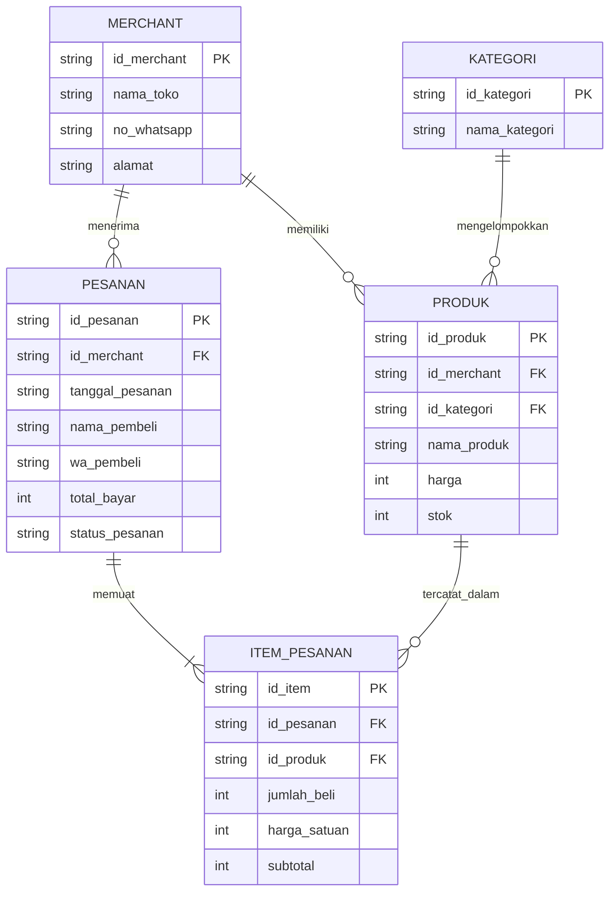

# Dokumentasi ERD Katalog UMKM (Bulan 1)

## 1. Diagram ERD (Mermaid)

## 2. Simulasi Data Transaksi Nyata
Skenario: Pada tanggal 12 November, Rina (WA: 081999888777) memesan 3 bungkus Keripik Tempe dengan harga Rp10.000 per bungkus dan 1 botol Sambal Roa dengan harga Rp25.000 dari Toko Dapur Minang.

1. Tabel PESANAN
id_pesanan (PK)	nama_pembeli	no_whatsapp	tanggal_pesanan	total_harga
PSN001	Rina	081999888777	12 November	Rp55.000

2. Tabel ITEM_PESANAN
id_item (PK)	id_pesanan (FK)	nama_produk	jumlah	harga_satuan	subtotal
ITM001	PSN001	Keripik Tempe	3	Rp10.000	Rp30.000
ITM002	PSN001	Sambal Roa	1	Rp25.000	Rp25.000

3. Perhitungan Total Pesanan
- Keripik Tempe: 3 × Rp10.000 = Rp30.000
- Sambal Roa: 1 × Rp25.000 = Rp25.000
Total pembayaran = Rp30.000 + Rp25.000 = Rp55.000.
## 3. Penjelasan Desain Skema