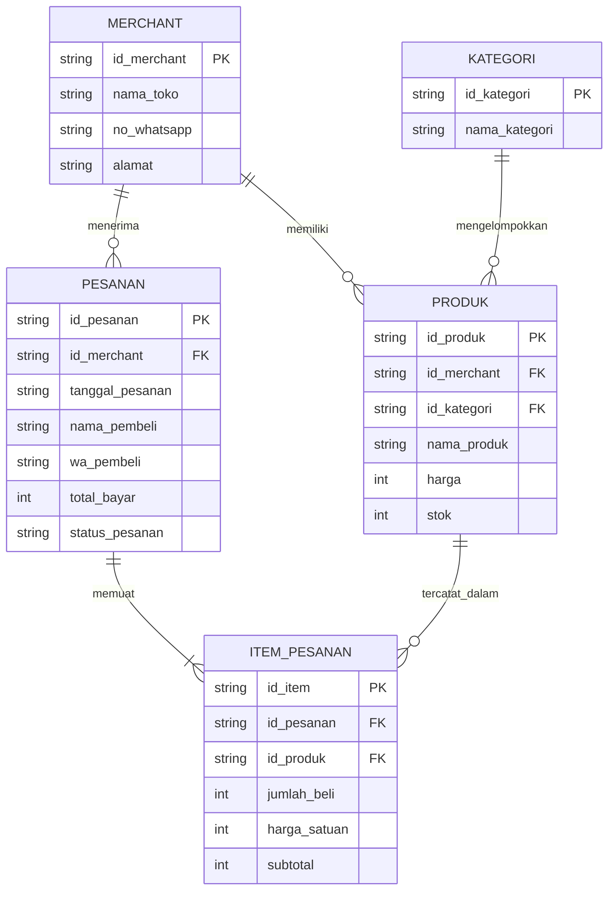

# Dokumentasi ERD Katalog UMKM (Bulan 1)

## 1. Diagram ERD (Mermaid)

## 2. Simulasi Data Transaksi Nyata
Berikut simulasi data transaksi Rina untuk tabel PESANAN dan ITEM_PESANAN.
1. Tabel PESANAN
Tabel ini menyimpan informasi utama transaksi Rina.
id_pesanan (PK)	id_merchant (FK)	nama_pembeli	no_wa	tanggal_pesanan	total_harga
PSN001	MRC001	Rina	081999888777	2026-11-12	Rp55.000

2. Tabel ITEM_PESANAN
Tabel ini menyimpan rincian produk yang dipesan Rina.
id_item (PK)	id_pesanan (FK)	id_produk (FK)	jumlah	harga_satuan	subtotal
ITM001	PSN001	PRD001	3	Rp10.000	Rp30.000
ITM002	PSN001	PRD002	1	Rp25.000	Rp25.000

3. Perhitungan Total Pesanan
- Keripik Tempe: 3 × Rp10.000 = Rp30.000
- Sambal Roa: 1 × Rp25.000 = Rp25.000
Total pembayaran: Rp55.000
4. Kesimpulan
Dari simulasi tersebut, dapat dibuktikan bahwa:
1. Satu baris pada tabel PESANAN menyimpan informasi transaksi Rina.
2. Dua baris pada tabel ITEM_PESANAN menyimpan rincian dua produk yang dipesan.
3. id_pesanan menjadi penghubung antara tabel PESANAN dan ITEM_PESANAN melalui Foreign Key (FK).
## 3. Penjelasan Desain Skema