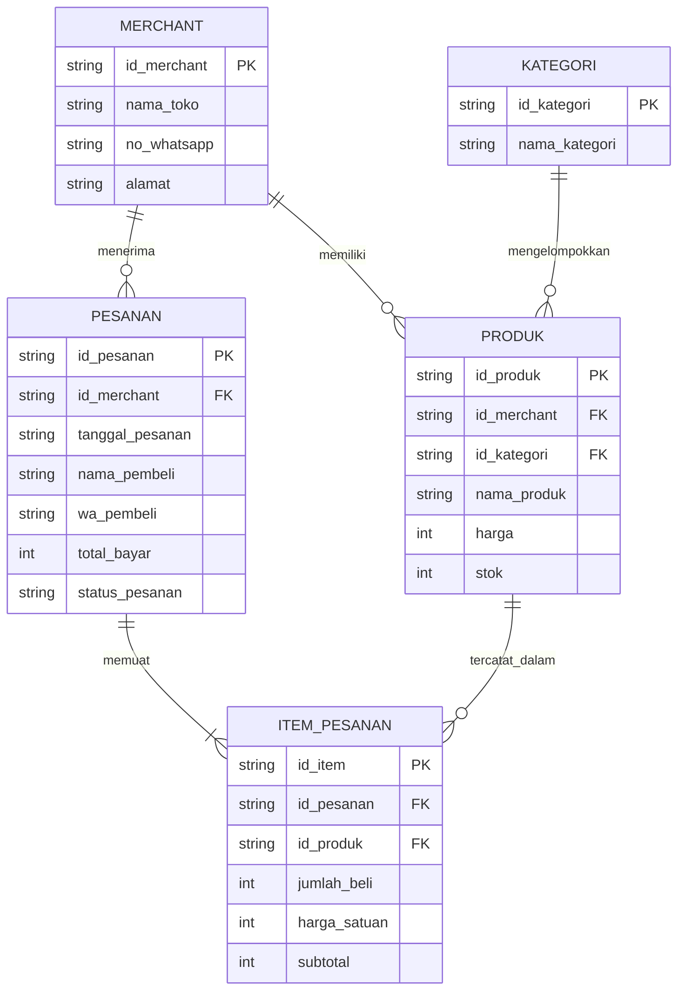

# Dokumentasi ERD Katalog UMKM (Bulan 1)

## 1. Diagram ERD (Mermaid)

## 2. Simulasi Data Transaksi Nyata
Skenario: Pada tanggal 12 November, Rina (WA: 081999888777) memesan 3 bungkus Keripik Tempe dengan harga Rp10.000 per bungkus dan 1 botol Sambal Roa dengan harga Rp25.000 dari Toko Dapur Minang.

### 1. Tabel PESANAN

| id_pesanan (PK) | nama_pembeli | no_whatsapp | tanggal_pesanan | total_harga |
|---|---|---|---|---|
| PSN001 | Rina | 081999888777 | 12 November | Rp55.000 |

### 2. Tabel ITEM_PESANAN

| id_item (PK) | id_pesanan (FK) | nama_produk | jumlah | harga_satuan | subtotal |
|---|---|---|---|---|---|
| ITM001 | PSN001 | Keripik Tempe | 3 | Rp10.000 | Rp30.000 |
| ITM002 | PSN001 | Sambal Roa | 1 | Rp25.000 | Rp25.000 |
3. Perhitungan Total Pesanan
- Keripik Tempe: 3 × Rp10.000 = Rp30.000
- Sambal Roa: 1 × Rp25.000 = Rp25.000
Total pembayaran = Rp30.000 + Rp25.000 = Rp55.000.

## 3. Penjelasan Desain Skema

Desain database Katalog UMKM dibuat untuk mengelola data toko, kategori produk, produk, pesanan, dan detail barang yang dibeli oleh pelanggan. Database ini terdiri dari lima tabel yang saling berhubungan.

1\. Tabel MERCHANT

Tabel MERCHANT digunakan untuk menyimpan informasi pemilik atau penjual UMKM.

Data yang disimpan meliputi:

- `id_merchant` sebagai Primary Key.
- `nama_toko` untuk menyimpan nama toko.
- `no_whatsapp` untuk menyimpan nomor WhatsApp penjual.
- `alamat` untuk menyimpan alamat toko.

2\. Tabel KATEGORI

Tabel KATEGORI digunakan untuk mengelompokkan produk berdasarkan jenisnya.

Data yang disimpan meliputi:

- `id_kategori` sebagai Primary Key.
- `nama_kategori` untuk menyimpan nama kategori produk.

3\. Tabel PRODUK

Tabel PRODUK digunakan untuk menyimpan informasi barang yang dijual oleh UMKM.

Data yang disimpan meliputi:

- `id_produk` sebagai Primary Key.
- `id_merchant` sebagai Foreign Key yang terhubung dengan tabel MERCHANT.
- `id_kategori` sebagai Foreign Key yang terhubung dengan tabel KATEGORI.
- `nama_produk` untuk menyimpan nama produk.
- `harga` untuk menyimpan harga produk.
- `stok` untuk menyimpan jumlah persediaan produk.

4\. Tabel PESANAN

Tabel PESANAN digunakan untuk menyimpan informasi transaksi pembelian pelanggan.

Data yang disimpan meliputi:

- `id_pesanan` sebagai Primary Key.
- `id_merchant` sebagai Foreign Key yang terhubung dengan tabel MERCHANT.
- `tanggal_pesanan` untuk menyimpan tanggal transaksi.
- `nama_pembeli` untuk menyimpan nama pelanggan.
- `wa_pembeli` untuk menyimpan nomor WhatsApp pelanggan.
- `total_bayar` untuk menyimpan total pembayaran.
- `status_pesanan` untuk menyimpan status pesanan.

5\. Tabel ITEM_PESANAN

Tabel ITEM_PESANAN digunakan untuk menyimpan rincian produk yang dibeli dalam setiap pesanan.

Data yang disimpan meliputi:

- `id_item` sebagai Primary Key.
- `id_pesanan` sebagai Foreign Key yang terhubung dengan tabel PESANAN.
- `id_produk` sebagai Foreign Key yang terhubung dengan tabel PRODUK.
- `jumlah_beli` untuk menyimpan jumlah produk yang dibeli.
- `harga_satuan` untuk menyimpan harga produk saat transaksi.
- `subtotal` untuk menyimpan hasil perkalian jumlah barang dengan harga satuan.

### Hubungan Antar Tabel

Hubungan antar tabel dalam database tersebut adalah:

1. Satu MERCHANT dapat memiliki banyak PRODUK.
2. Satu KATEGORI dapat mengelompokkan banyak PRODUK.
3. Satu MERCHANT dapat menerima banyak PESANAN.
4. Satu PESANAN dapat memiliki satu atau lebih ITEM_PESANAN.
5. Satu PRODUK dapat tercatat dalam banyak ITEM_PESANAN.

### Kesimpulan

Desain database Katalog UMKM menggunakan lima tabel yang saling berhubungan untuk mengelola data toko, produk, kategori, dan transaksi pembelian. Penggunaan Primary Key dan Foreign Key membantu menghubungkan data antar tabel agar lebih terstruktur, mengurangi pengulangan data, dan memudahkan proses pencatatan serta pengelolaan transaksi UMKM.
