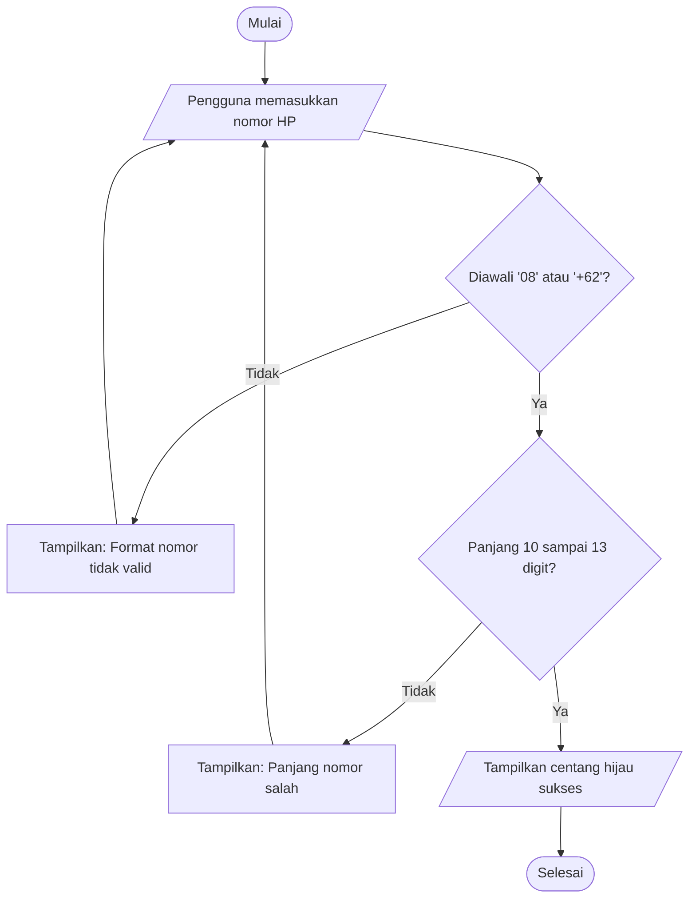

# Tugas Mandiri 02c — Flowchart Validasi Nomor WhatsApp
Nama: [Ahmad Yazid]

## 1. Flowchart (Mermaid)

## 2. Penjelasan Singkat

- Ada dua syarat yang dicek berurutan: awalan nomor, lalu panjang nomor.
- Setiap diamond keputusan punya dua panah keluar (Ya dan Tidak), sehingga tidak ada jalur yang buntu.
- Jalur "Tidak" selalu kembali ke langkah input, jadi pengguna diminta memasukkan nomor lagi sampai valid.
- Hanya jalur yang lolos kedua pengecekan yang berakhir di tanda centang sukses.

## 3. Uji Dry Run

| Nomor | Awalan valid? | Panjang valid? | Hasil |
|-------|---------------|----------------|-------|
| 081234567890 (12 digit) | Ya | Ya | Centang sukses |
| 0712345678 | Tidak | - | Format nomor tidak valid, input ulang |
| 0812345 (7 digit) | Ya | Tidak | Panjang nomor salah, input ulang |

## 4. Refleksi Singkat

[Tulis refleksimu sendiri dengan 2–3 kalimat: apa yang paling menantang saat mengubah syarat validasi menjadi flowchart?]
