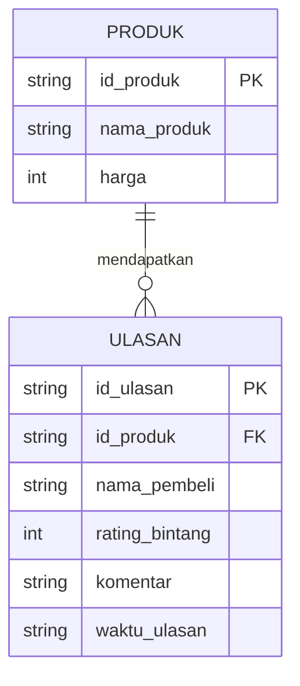

# Tugas Mandiri 02d — Model Data Fitur Ulasan Produk
Nama:Ahmad Yazid

## 1. Struktur Entitas Baru: ULASAN

## 2. Daftar Atribut ULASAN

| Atribut | Tipe Data | Kunci | Keterangan |
|---------|-----------|-------|------------|
| id_ulasan | string | PK | Pengenal unik tiap ulasan |
| id_produk | string | FK | Menunjuk ke `id_produk` di entitas PRODUK |
| nama_pembeli | string | - | Nama pembeli yang menulis ulasan |
| rating_bintang | int | - | Nilai bintang 1 sampai 5 |
| komentar | string | - | Komentar singkat pembeli |
| waktu_ulasan | string | - | Waktu ulasan dibuat |

## 3. Penjelasan Relasi & Kunci:
- **Relasi:** Satu ke Banyak (`1 : N`). Satu `PRODUK` bisa mendapatkan banyak `ULASAN` dari berbagai pembeli (atau 0 ulasan jika belum ada yang mengulas, sehingga memakai simbol `||--o{`), tetapi satu baris `ULASAN` hanya tertuju pada satu produk tertentu.
- **Kunci Utama (PK):** `id_ulasan` membedakan satu ulasan dari ulasan lainnya, sehingga tidak ada dua baris ulasan yang sama.
- **Kunci Tamu (FK):** Atribut `id_produk` pada tabel `ULASAN` berfungsi sebagai Foreign Key yang menunjuk ke `id_produk (PK)` milik entitas `PRODUK`.
- **Aturan data:** `rating_bintang` hanya boleh bernilai 1 sampai 5.

## 4. Refleksi Singkat:
[Tulis refleksimu sendiri dengan 2–3 kalimat: apa yang paling membantu kamu memahami hubungan PK dan FK?]
