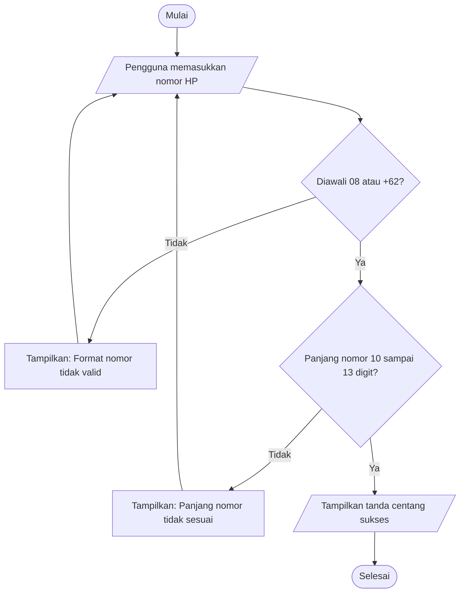

# Tugas Mandiri 02c — Flowchart Validasi Nomor WhatsApp

**Nama:** Aliffuddin Adilla Rafif

## 1. Flowchart Validasi Nomor WhatsApp

## 2. Penjelasan Flowchart

1. **Mulai:** Proses validasi nomor WhatsApp dimulai.
2. **Input nomor HP:** Pengguna memasukkan nomor telepon.
3. **Cek format:** Sistem memeriksa apakah nomor diawali dengan 08 atau +62.
4. **Cek panjang:** Jika format benar, sistem memeriksa apakah panjang nomor antara 10 sampai 13 digit.
5. **Jika tidak valid:** Sistem menampilkan pesan kesalahan dan meminta pengguna memasukkan nomor kembali.
6. **Jika valid:** Sistem menampilkan tanda centang sebagai tanda bahwa nomor berhasil divalidasi.
7. **Selesai:** Proses validasi berakhir.

## 3. Cek Pemahaman Diri

**1. Apa kesalahan fatal yang terjadi jika sebuah diamond keputusan (decision) hanya memiliki satu panah keluar?**

Jawaban:

Jika diamond keputusan hanya memiliki satu panah keluar, maka alur logika menjadi tidak lengkap karena tidak ada pilihan untuk kondisi lainnya. Akibatnya, sistem tidak bisa menentukan langkah yang harus dilakukan ketika kondisi bernilai benar atau salah.

**2. Mengapa dalam scope Bulan 1 pemesanan langsung diteruskan ke WhatsApp alih-alih membangun keranjang belanja checkout yang rumit?**

Jawaban:

Karena meneruskan pemesanan ke WhatsApp lebih sederhana dan mudah dibuat untuk tahap awal. Pengguna juga bisa langsung berkomunikasi dengan penjual untuk melakukan pemesanan. Dengan begitu, pengembangan website menjadi lebih cepat dan tidak membutuhkan sistem checkout yang rumit.