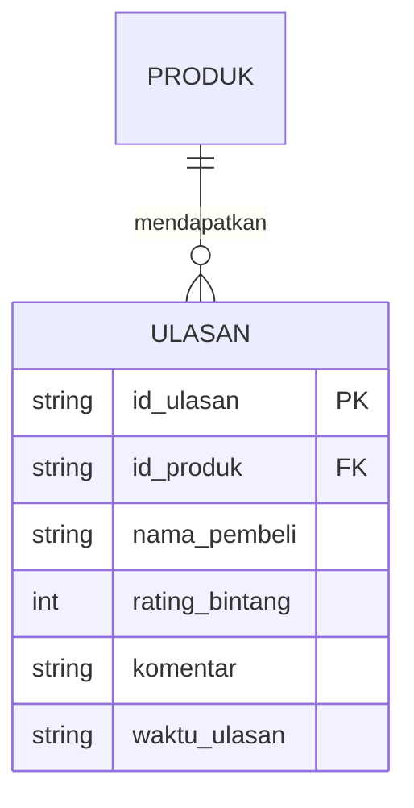

# Tugas Mandiri 02d — Model Data Fitur Ulasan Produk

**Nama:** Aliffuddin Adilla Rafif

## 1. Struktur Entitas Baru: ULASAN

Entitas ULASAN digunakan untuk menyimpan penilaian dan komentar dari pembeli terhadap produk yang telah dibeli.

### Daftar Atribut ULASAN

| Atribut | Tipe Data | Keterangan |
|---|---|---|
| id_ulasan | string | Primary Key (PK), identitas unik ulasan |
| id_produk | string | Foreign Key (FK), penghubung ke tabel PRODUK |
| nama_pembeli | string | Nama orang yang memberikan ulasan |
| rating_bintang | int | Penilaian produk dari 1 sampai 5 |
| komentar | string | Pendapat pembeli mengenai produk |
| waktu_ulasan | string | Tanggal dan waktu ulasan dibuat |

## 2. Penjelasan Relasi dan Kunci

**Relasi: One to Many (1:N)**

Satu produk dapat memiliki banyak ulasan dari pembeli yang berbeda. Sebaliknya, satu ulasan hanya ditujukan untuk satu produk tertentu.

Contohnya, produk Panci bisa mendapatkan 10 ulasan dari pembeli yang berbeda, sedangkan setiap ulasan hanya membahas produk Panci tersebut.

**Primary Key (PK):**
- `id_ulasan` digunakan sebagai identitas unik untuk setiap ulasan agar tidak tertukar dengan ulasan lainnya.

**Foreign Key (FK):**
- `id_produk` digunakan untuk menghubungkan ulasan dengan produk yang mendapatkan penilaian.

## 3. Kesimpulan

Dengan adanya entitas ULASAN, pelanggan dapat memberikan penilaian berupa bintang dan komentar terhadap produk yang dibeli. Fitur ini diharapkan dapat membantu calon pembeli mengetahui pengalaman pelanggan sebelumnya sehingga meningkatkan kepercayaan terhadap katalog UMKM.