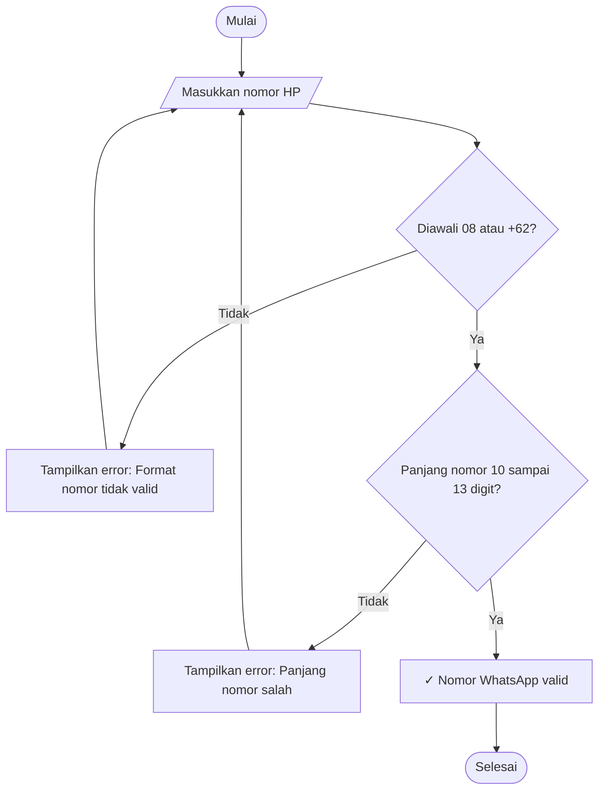

# Tugas Mandiri 02c — Flowchart Validasi Nomor WhatsApp

Nama: [Isi Nama Kamu]

## 1. Tujuan Flowchart

Flowchart ini dibuat untuk memeriksa apakah nomor WhatsApp Indonesia yang dimasukkan oleh pengguna sudah sesuai dengan ketentuan.

## 2. Aturan Validasi

Nomor WhatsApp dinyatakan valid apabila memenuhi dua syarat:

1. Nomor harus diawali dengan `08` atau `+62`.
2. Panjang nomor harus antara 10 sampai 13 digit.

Jika nomor tidak memenuhi syarat, sistem akan menampilkan pesan kesalahan dan meminta pengguna memasukkan nomor kembali.

Jika nomor memenuhi semua syarat, sistem akan menampilkan tanda centang sebagai tanda berhasil.

## 3. Kode Flowchart Mermaid

## 4. Kesimpulan

Flowchart ini membantu memeriksa format nomor WhatsApp Indonesia secara sederhana. Pengguna harus memasukkan nomor dengan awalan 08 atau +62 dan panjang nomor antara 10 sampai 13 digit. Apabila nomor tidak sesuai, pengguna diminta mengulangi input. Apabila semua persyaratan terpenuhi, nomor dinyatakan valid.
