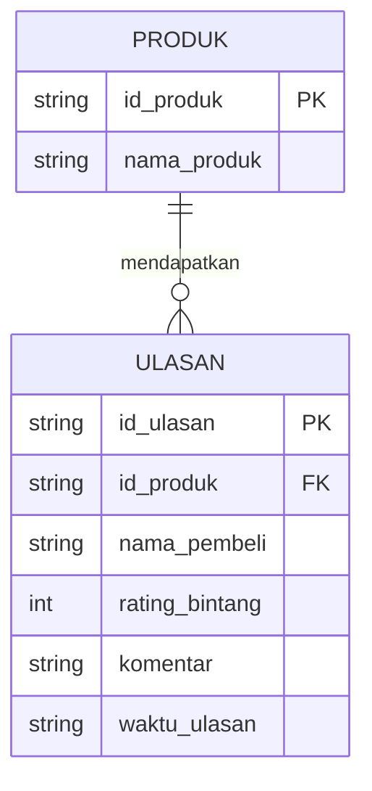

# Tugas Mandiri 02d — Model Data Fitur Ulasan Produk
Nama: [Dedy]

## 1. Struktur Entitas Baru: ULASAN

## 2. Penjelasan Relasi & Kunci
- **Jenis Relasi (`1 : N`):** Hubungan antara entitas `PRODUK` dan `ULASAN` adalah **Satu ke Banyak (*One-to-Many*)**. Satu produk dapat memiliki nol hingga banyak ulasan dari berbagai pembeli yang berbeda (ditandai simbol kardinalitas `||--o{`), sedangkan satu data ulasan hanya merujuk pada satu produk saja.
- **Primary Key (PK):** Atribut `id_ulasan` berperan sebagai kunci utama yang membedakan setiap baris komentar agar tidak terjadi duplikasi data.
- **Foreign Key (FK):** Atribut `id_produk` pada entitas `ULASAN` berperan sebagai kunci tamu yang merujuk langsung ke `id_produk (PK)` pada entitas `PRODUK` agar sistem mengetahui ulasan tersebut milik barang yang mana.
