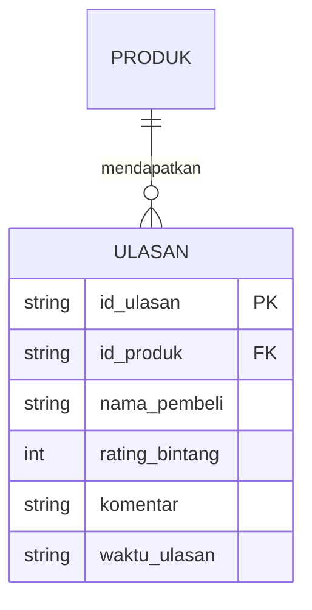
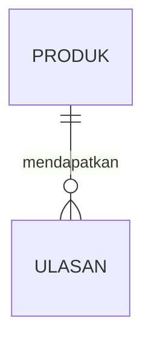

# TUGAS MANDIRI 02D – MODEL DATA FITUR ULASAN PRODUK

**Nama:** Hanif Abdurrahman Arrifa'i

## 1. Struktur Entitas Baru: ULASAN

Untuk mendukung fitur ulasan singkat produk pada halaman katalog, diperlukan satu entitas baru bernama **ULASAN**. Entitas ini digunakan untuk menyimpan penilaian dan komentar pembeli terhadap produk yang telah dibeli.

Berikut adalah struktur entitas ULASAN beserta atributnya:

### Daftar Atribut Entitas ULASAN

| No. | Nama Atribut | Tipe Data | Keterangan |
|---|---|---|---|
| 1 | id_ulasan | string | Primary Key (PK), identitas unik setiap ulasan |
| 2 | id_produk | string | Foreign Key (FK), menghubungkan ulasan dengan produk |
| 3 | nama_pembeli | string | Nama pembeli yang memberikan ulasan |
| 4 | rating_bintang | int | Penilaian produk menggunakan bintang 1–5 |
| 5 | komentar | string | Isi komentar atau pendapat pembeli mengenai produk |
| 6 | waktu_ulasan | string | Waktu ketika pembeli memberikan ulasan |

## 2. Penjelasan Relasi dan Kunci

### A. Relasi Antarentitas

Relasi antara entitas **PRODUK** dan **ULASAN** adalah **One-to-Many (1:N)** atau satu ke banyak.

Artinya, satu produk dapat memperoleh banyak ulasan dari berbagai pembeli. Sebaliknya, satu ulasan hanya ditujukan kepada satu produk.

Contohnya:
- Produk A dapat memiliki 10 ulasan dari pembeli yang berbeda.
- Produk B dapat memiliki 5 ulasan.
- Produk C dapat belum memiliki ulasan sama sekali.

Dengan demikian, satu produk dapat memiliki nol atau banyak ulasan, sedangkan setiap ulasan harus terhubung dengan satu produk.

### B. Primary Key (PK)

Atribut `id_ulasan` berfungsi sebagai Primary Key (PK).

Primary Key merupakan atribut yang digunakan sebagai identitas unik untuk setiap data ulasan. Setiap ulasan memiliki ID yang berbeda sehingga tidak terjadi duplikasi identitas.

Contohnya:
- UL001
- UL002
- UL003

### C. Foreign Key (FK)

Atribut `id_produk` berfungsi sebagai Foreign Key (FK) pada entitas ULASAN.

Foreign Key digunakan untuk menghubungkan data ulasan dengan entitas PRODUK melalui atribut `id_produk` yang menjadi Primary Key pada entitas PRODUK.

Dengan adanya Foreign Key, setiap ulasan dapat diketahui berasal dari produk yang mana.

## 3. Penjelasan Kode Mermaid

Kode Mermaid yang digunakan adalah:

Penjelasan simbol pada kode tersebut:

- `PRODUK` menunjukkan entitas produk.
- `ULASAN` menunjukkan entitas ulasan.
- `||` menunjukkan bahwa setiap ulasan harus berhubungan dengan tepat satu produk.
- `o{` menunjukkan bahwa satu produk dapat memiliki nol atau banyak ulasan.
- `mendapatkan` merupakan nama relasi antara kedua entitas.

## 4. Kesimpulan

Berdasarkan perancangan model data di atas, penambahan entitas ULASAN dapat mendukung pengembangan fitur ulasan singkat produk pada halaman katalog.

Entitas ULASAN memiliki enam atribut, yaitu `id_ulasan`, `id_produk`, `nama_pembeli`, `rating_bintang`, `komentar`, dan `waktu_ulasan`.

Atribut `id_ulasan` digunakan sebagai Primary Key (PK), sedangkan `id_produk` digunakan sebagai Foreign Key (FK) yang menghubungkan entitas ULASAN dengan entitas PRODUK.

Relasi antara kedua entitas tersebut adalah One-to-Many (1:N), karena satu produk dapat menerima banyak ulasan dari pembeli yang berbeda, sementara satu ulasan hanya dimiliki oleh satu produk.

Dengan adanya rancangan ini, sistem katalog produk dapat menampilkan penilaian berupa bintang dan komentar pembeli sehingga calon pembeli dapat memperoleh informasi tambahan mengenai produk yang ingin dibeli.
